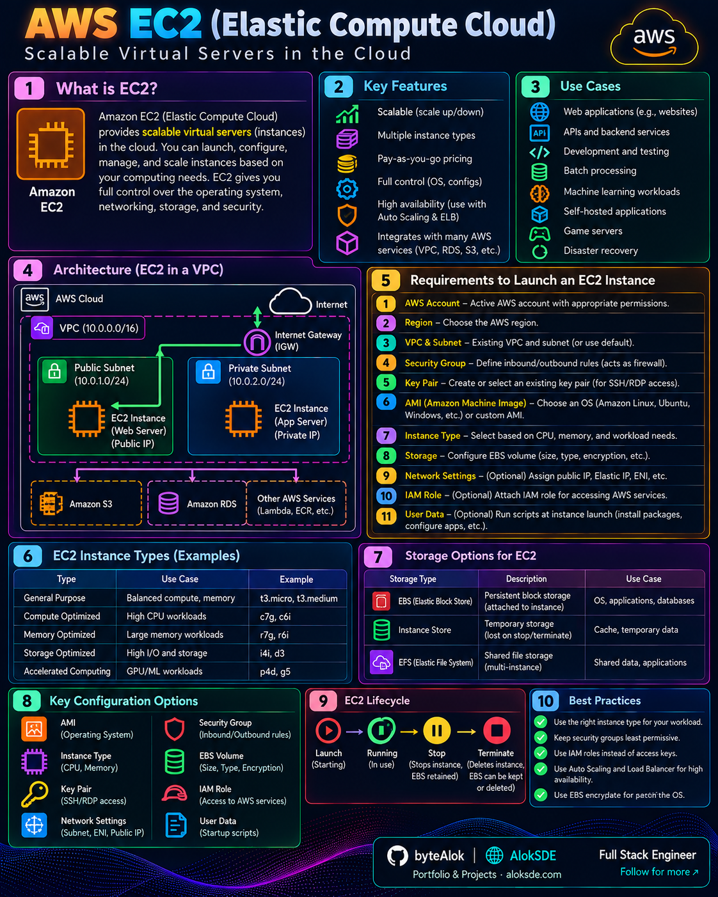

# 🖥️ Compute

Visual notes and architecture diagrams for cloud computing services.

## Amazon EC2

Amazon Elastic Compute Cloud (EC2) provides scalable virtual computing capacity in AWS.

[🔍 Open Full Image](AWS-EC2.png)

---

More AWS, Azure, and GCP compute service comparisons will be added here.
