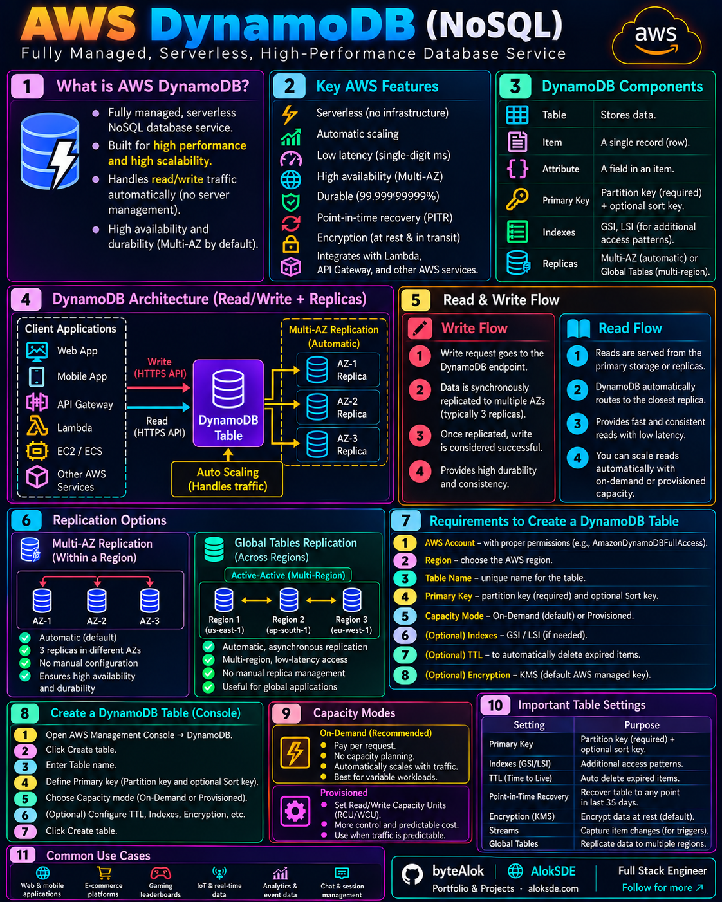
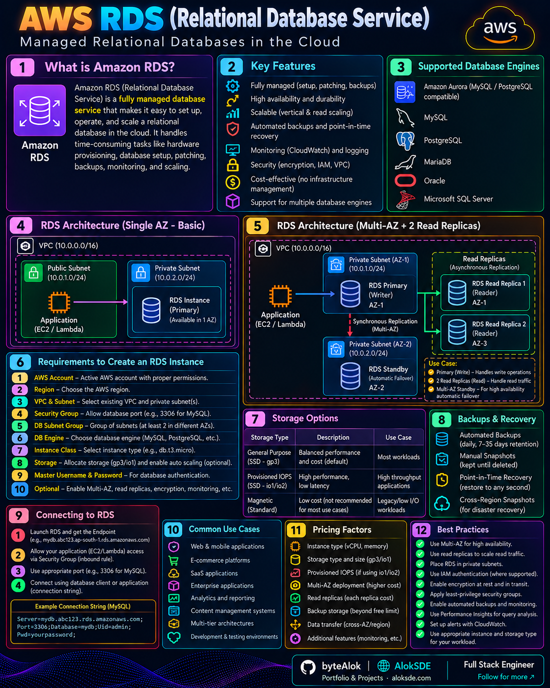

# 🗄️ Databases

Visual notes and comparisons of managed database services across cloud platforms.

## Amazon DynamoDB

A fully managed NoSQL database service designed for scalable, low-latency applications.

[🔍 Open Full Image](AWS-DynamoDB.png)

---

## Amazon RDS

A managed relational database service that simplifies database administration.

[🔍 Open Full Image](AWS-RDS.png)

---

More relational and NoSQL database comparisons will be added here.
