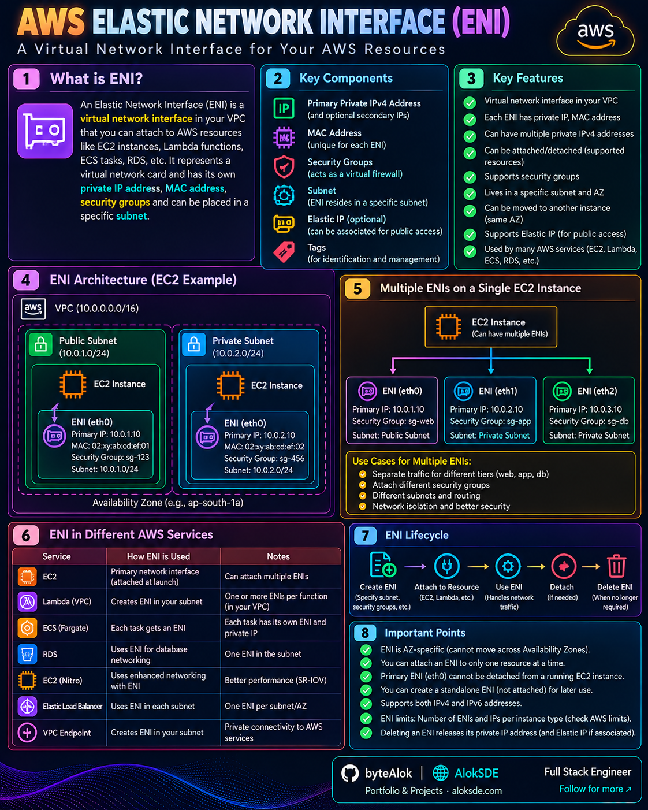
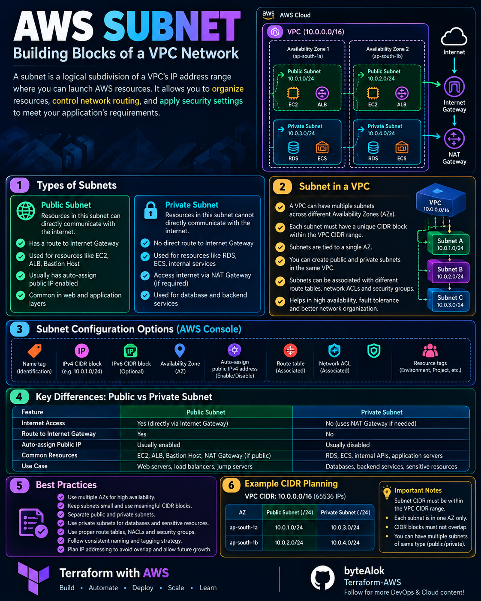

# 🌐 Networking

Visual notes for cloud networking, connectivity, routing, and network architecture.

## 📚 Topics

### VPC / VNet / VPC Network

Compare virtual networking concepts across AWS, Azure, and GCP.

➡️ [Open VPC Comparison](VPC-VNet-VPC/)

### AWS Elastic Network Interface (ENI)

A virtual network interface that can be attached to an EC2 instance.

[🔍 Open Full Image](AWS-ENI.png)

---

### Internet Gateway & NAT Gateway

Understand internet connectivity and outbound access in AWS VPCs.

[🔍 Open Full Image](<AWS-Internet & NAT Gateway.png>)

---

### Route Tables

Route tables determine where network traffic is directed.

[🔍 Open Full Image](<AWS-Route Table.png>)

---

### Subnets

Subnets divide a VPC's IP address range into smaller network segments.

[🔍 Open Full Image](AWS-Subnets.png)

---

More AWS, Azure, and GCP networking comparisons will be added here.
