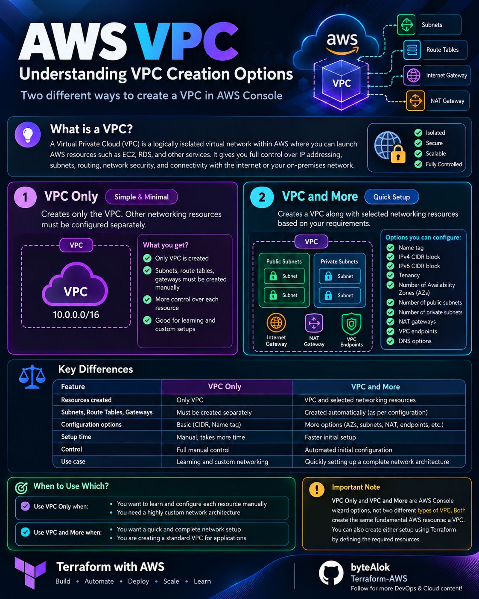

# 🌐 VPC vs VNet vs VPC Network

Compare virtual networking across AWS, Azure, and GCP.

## 🟠 AWS — Virtual Private Cloud (VPC)

[🔍 Open Full Image](AWS-VPC.png)

## 🔵 Azure — Virtual Network (VNet)

[🔍 Open Full Image](Azure-VNet.png)

## 🟢 GCP — VPC Network

[🔍 Open Full Image](GCP-VPC.png)

## 📊 Key Differences

Explain the architecture, subnet behaviour, routing,
and security differences between the three services.

## 📚 Official Documentation

- [AWS VPC](https://docs.aws.amazon.com/vpc/)
- [Azure Virtual Network](https://learn.microsoft.com/en-us/azure/virtual-network/)
- [GCP VPC](https://cloud.google.com/vpc/docs)

