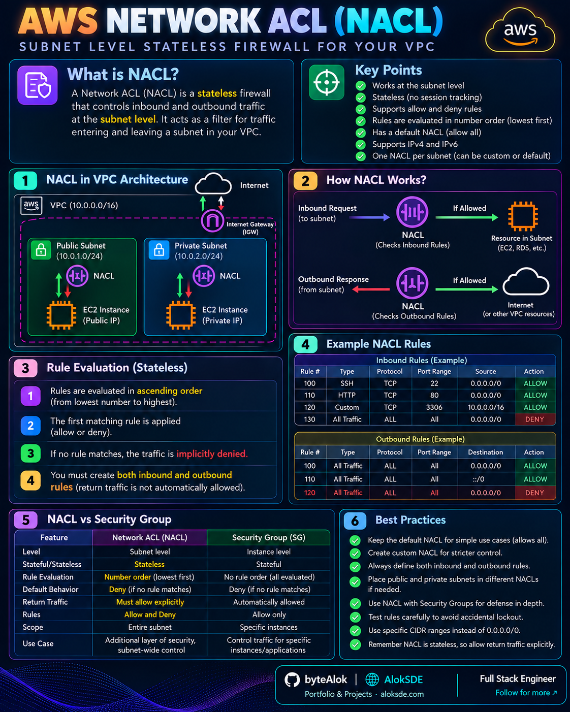

# 🔐 Security

Visual notes covering cloud security controls and network traffic protection.

## AWS Network Access Control List (NACL)

A network-level control that evaluates inbound and outbound traffic using numbered rules.

[🔍 Open Full Image](AWS-NACL.png)

---

## AWS Security Groups

Virtual firewalls that control inbound and outbound traffic for supported AWS resources.

[🔍 Open Full Image](<AWS-Security Group.png>)

---

## Topics to Explore

- IAM and access policies
- Network security controls
- Encryption and key management
- Secrets management
- Web application firewall and DDoS protection

More cross-cloud security comparisons will be added here.
