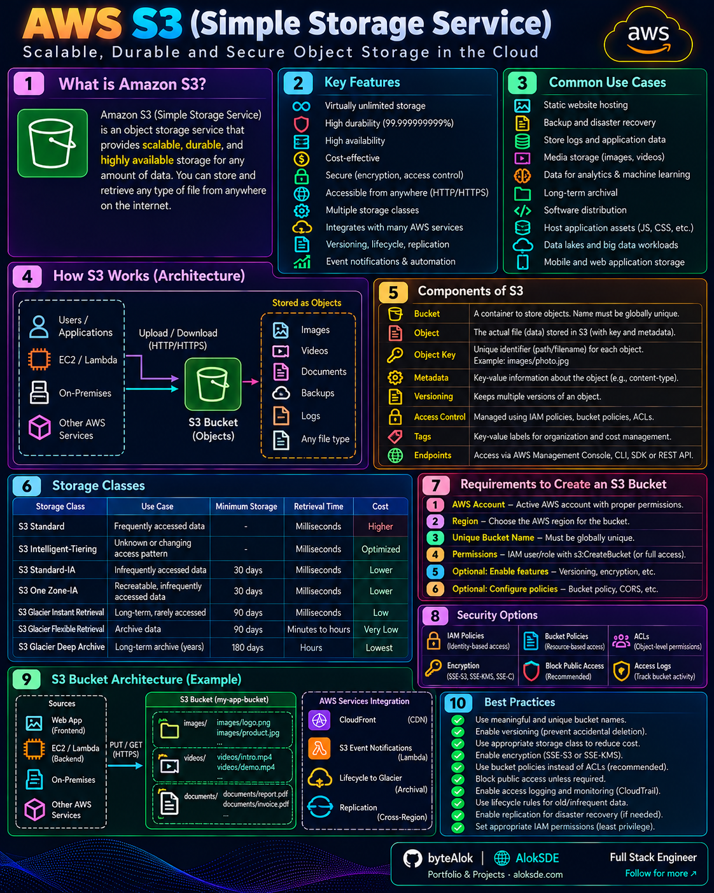

# 💾 Storage

Visual notes covering cloud storage services and data management.

## Amazon S3

Amazon Simple Storage Service (S3) is an object storage service designed to store and retrieve data at scale.

[🔍 Open Full Image](AWS-S3.png)

---

## Topics to Explore

- Object storage
- Block storage
- File storage
- Storage classes and lifecycle policies
- Replication and backup
- Data transfer

More AWS, Azure, and GCP storage comparisons will be added here.
